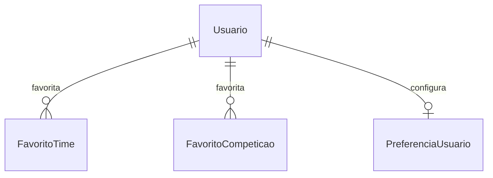
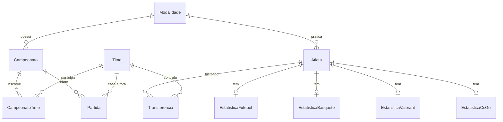

# Modelagem do SportStats

Documento de referência da modelagem. Nada daqui é executado pelo `Database/script.sql`.

## 1. Escopo

| Fase | Dados esportivos (times, atletas, partidas) | Banco de dados |
|---|---|---|
| **P2 (entrega atual)** | Ficam no MySQL, cadastrados via CRUD e `script.sql` (exigência do manual: Dapper + script) | Todas as tabelas do `script.sql` |
| **Futuro** | Chegam por **WebSocket** (fonte externa, tempo real) | Só dados do próprio sistema (usuário e afins) |

## 2. Camada A: dados esportivos

Hoje persistidos no MySQL. No futuro, recebidos pelo WebSocket (cache em memória, sem tabela própria).

| Entidade | Campos principais | Observação |
|---|---|---|
| Modalidade | Nome, Grupo (`esportes`/`esports`), Slug | Hoje fixa em `CatalogoModalidades` |
| Campeonato | Nome, Temporada, Modalidade | |
| Time | Nome, Sigla, Cidade | |
| Atleta | Nome, Nickname, Nacionalidade, Posição, DataNascimento | Nickname só em e-sports |
| Transferência | Atleta, Time, DataInicio, DataFim | Histórico N:N; DataFim nula = time atual |
| Partida | Campeonato, TimeCasa, TimeFora, Tipo, DataHora, Placar, **Status**, **Minuto**, Fase, MelhorDe | Subclasses por modalidade (polimorfismo) |
| Parcial da partida | Número, Descrição, PlacarCasa, PlacarFora | Tempos, quartos, sets ou mapas |
| Evento da partida | Tipo (gol, cartão, substituição), Minuto, Atleta, Time | |
| Escalação | Partida, Atleta, Time, Titular, Minutos, Nota | Base da regra de escalação inválida |
| Estatística do atleta | Uma por modalidade (Futebol, Basquete, Vôlei, Valorant, CS, LoL) | Cada uma com `CalcularRating()` |

Campos extras previstos nas estatísticas:
- **Basquete:** ArremessosTentados e ArremessosConvertidos (aproveitamento).
- **Valorant:** Função do jogador.
- **LoL:** Mortes, Campeão e Função.
- **Vôlei:** Pontos, Aces, Bloqueios e Ataques.

Regras de integridade desejadas:
- Time não joga contra ele mesmo.
- `DataFim >= DataInicio` na transferência.
- `Status` só aceita `Agendada`, `AoVivo` ou `Encerrada`.
- Aproveitamento: convertidos <= tentados.
- Um atleta só tem um time ativo.

### Contrato do WebSocket (proposta)
Quando os dados vierem de fora, os ids passam a ser **externos** (texto), não mais inteiros do banco:

```json
{
  "tipo": "placar",
  "partidaId": "ext-12345",
  "modalidade": "futebol",
  "status": "AoVivo",
  "minuto": 67,
  "casa": { "id": "ext-t1", "nome": "Atlético Norte", "placar": 2 },
  "fora": { "id": "ext-t2", "nome": "Real Cidade", "placar": 1 },
  "parciais": [ { "numero": 1, "descricao": "Primeiro tempo", "casa": 1, "fora": 0 } ],
  "eventos": [ { "tipo": "Gol", "minuto": 12, "atletaId": "ext-a1", "timeId": "ext-t1" } ]
}
```
A tarefa BACK-05 (SignalR) deve alinhar a mensagem do hub com este formato.

## 3. Camada B: dados persistidos no banco (futuro)

Só o que pertence ao sistema. Como times e competições virão de fora, os favoritos guardam o **id externo** e a origem.

```sql
-- REFERENCIA (nao executar ainda)
CREATE TABLE Usuario (
    Id INT AUTO_INCREMENT PRIMARY KEY,
    Nome VARCHAR(100) NOT NULL,
    Email VARCHAR(150) NOT NULL UNIQUE,
    SenhaHash VARCHAR(255) NOT NULL,
    CriadoEm DATETIME NOT NULL DEFAULT CURRENT_TIMESTAMP
);

CREATE TABLE FavoritoTime (
    UsuarioId INT NOT NULL,
    Origem VARCHAR(30) NOT NULL,
    TimeIdExterno VARCHAR(60) NOT NULL,
    NomeCache VARCHAR(80) NULL,
    PRIMARY KEY (UsuarioId, Origem, TimeIdExterno),
    FOREIGN KEY (UsuarioId) REFERENCES Usuario(Id)
);

CREATE TABLE FavoritoCompeticao (
    UsuarioId INT NOT NULL,
    Origem VARCHAR(30) NOT NULL,
    CompeticaoIdExterno VARCHAR(60) NOT NULL,
    NomeCache VARCHAR(100) NULL,
    PRIMARY KEY (UsuarioId, Origem, CompeticaoIdExterno),
    FOREIGN KEY (UsuarioId) REFERENCES Usuario(Id)
);

CREATE TABLE PreferenciaUsuario (
    UsuarioId INT PRIMARY KEY,
    GrupoPadrao VARCHAR(10) NOT NULL DEFAULT 'esportes',
    ModalidadeSlug VARCHAR(20) NULL,
    FOREIGN KEY (UsuarioId) REFERENCES Usuario(Id)
);
```

Cuidados:
- Guardar **hash** da senha (ex.: BCrypt), nunca texto puro.
- Sem CPF: não é necessário e exige cuidado com LGPD. Se um dia for preciso, usar `VARCHAR(11)`, nunca `INT`.
- Evitar Entity Framework e Identity: o acesso a dados continua com Dapper.

## 4. Diagrama (futuro)



Diagrama da camada esportiva (P2, banco atual):



## 5. Decisões em aberto

- Qual provedor ou API vai alimentar o WebSocket.
- Se haverá cache em banco do que chega pelo WebSocket (histórico de partidas encerradas).
- Login: e-mail e senha próprios ou login social.
- Quais notificações o usuário poderá receber (início de jogo, gol).